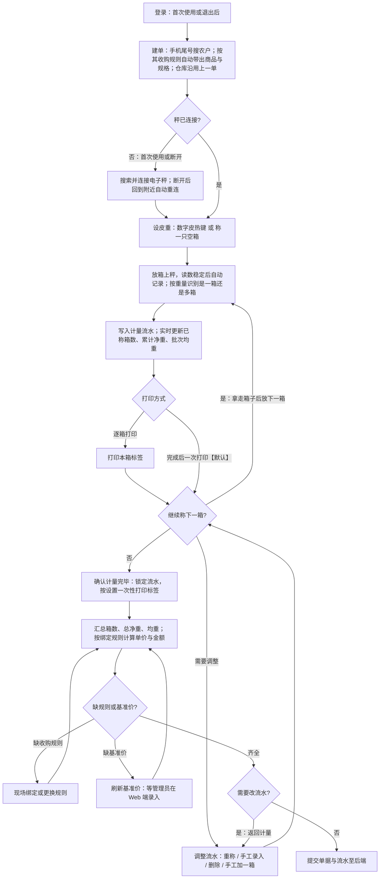

# 鸡蛋采购入库解决方案 · 需求规格说明书（v7）

- **文档定位**：项目唯一事实来源（Source of Truth），供产品、研发、测试直接执行与验收
- **覆盖范围**：Web 管理端 · Android APP · 后端服务 · 畅捷通好生意集成 · 蓝牙秤与标签打印机接入
- **交互原型**（均可在浏览器直接打开）：
  - `lab/app-sim.html`：APP。左侧为 APP 界面，右侧为模拟秤与打印机
  - `lab/web-sim.html`：Web 管理端。右下角“模拟”可切换最坏情况数据、模拟回传失败
  - 本文写明业务规则与交互约定，界面细节以原型为准
- **与 v1 的关系**：v1（《鸡蛋解决方案业务流程》）是业务方的原始要求。本文逐条落实 v1，没有推翻其中任何一条；细化与补充之处都注明了来源，逐条对照见第 11 章
- **标记说明**：
  - **【默认】**：业务未另行指定时的工程默认实现，可直接落地；若业务方有新要求再行调整
  - **【新增】/【修改】**：相对 v6 新增或改动的条目，汇总见第 10 章
  - **【待确认 Q-xx】**：尚未拍板的事项，目前仅剩 `Q-03`，见 8.1
  - **【联调检查 T-xx】**：开工后用真机或真实账套验证的事项，均已给出兜底做法，不阻塞开发，见 8.2
- **相对 v6 的主要变化**：
  1. 补齐 Web 管理端的做法（来自网页端原型评审）：单据状态、自主建单的录入窗口、审核与回传失败的处理、Web 端交互约定
  2. 回传失败的单除“重新回传”外，可“退回待审核”后修改
  3. 合并称重识别阈值定为后端参数，不进系统设置页（v6 前后写法不一致）
  4. 写明好生意“单据”同步的口径
  5. 新增第 11 章：与 v1 逐条对照

---

## 1 系统范围与技术架构

### 1.1 业务概述

产区供应链企业向周边农户和养殖场收购鸡蛋，再向全国市场批发、转运和销售。现场收购时，磅秤员使用 Android APP 连接蓝牙电子秤和便携标签打印机，逐箱称重、扣减皮重、记录计量流水；确认计量完毕后打印单箱标签（也可设置为逐箱打印），系统汇总批次均重，按农户绑定的定价规则计算收购单价与金额，生成采购入库单；Web 管理端核对、审核后回传至用友畅捷通好生意。

### 1.2 职责边界

- **本系统负责**（畅捷通生态 ISV 行业实现）：同步并展示好生意基础档案；维护蛋品包装规格、标准净含量、包装箱皮重、市场基准价与定价规则；维护系统设置与磅秤员账号；APP 现场称重打标与建单、Web 端自主建单；单据修改、审核与采购入库单回传。
- **畅捷通好生意负责**：基础档案源头管理、接收正式采购入库单、ERP 库存管理与成本核算。
- **本期不做**：库存与成本核算；销售发货单据作业流程（本期仅在定价规则中区分“发货规则”属性并支持绑定客户）。

### 1.3 组件与技术选型

| 组成部分 | 技术选型 | 核心职责 |
|---|---|---|
| Web 管理端 | Vue（优先使用 Vue，可选用更合适的前端框架） | 同步并展示好生意档案；维护规格、标准净含量、皮重热键、每日基准价、定价规则、系统设置、磅秤员账号；自主建单；接收、修改、审核单据并触发回传 |
| Android APP | Kotlin + 原生 View 体系（禁用 Jetpack Compose） | 登录；连接蓝牙电子秤与标签打印机；检索农户并建单；称重、去皮、自动记录、调整流水、打印标签；确认计量、汇总计价、调阅/调整规则、提交单据 |
| 后端服务 | Java + Spring Boot + MySQL（单体架构） | 存储同步档案与业务数据；集中执行计价逻辑；账号登录鉴权；提供 Web 与 APP 全部数据接口；统一调用好生意开放接口【默认】 |
| 蓝牙电子秤 | 蓝石蓝牙电子秤（BLE，蓝石数据提供 Android SDK） | 实时输出重量与稳定状态，执行称重去皮与数字皮设置 |
| 标签打印机 | 佳博手持式蓝牙标签打印机 GP-M32B（提供 Android SDK） | 按单箱流水打印不干胶追溯标签（蓝牙连接方式见 `T-01`） |

---

## 2 业务术语与计价公式

### 2.1 核心术语

| 术语 | 定义 |
|---|---|
| 粉蛋 / 红蛋 | 鸡蛋品种，即粉皮鸡蛋（北方居多）和红皮鸡蛋（南方居多），对应商品档案 |
| 包装规格 | 每箱鸡蛋枚数，通行规格为 `240枚/箱`、`360枚/箱`、`480枚/箱`，规格支持新增与编辑 |
| 双单位制 | 同时计量箱数（`箱`）与每箱净含量（`kg`） |
| 毛重 / 皮重 / 净重 | 毛重为箱与蛋总重；皮重为包装箱重量；`净重 = 毛重 − 包装箱皮重` |
| 包装箱皮重与热键 | 常用包装箱规格固定、重量稳定（如 `2号包装箱 = 2kg`），在系统中预定义并设为热键，收购时直接选用扣减 |
| 称重皮 | 将**一只**空箱放上秤，调用电子秤 SDK 实测去皮，得到每箱皮重 |
| 数字皮 | 从预定义皮重列表中选择已知皮重，通过电子秤 SDK 设置 |
| 合并称重 | 一次把多箱同时放上秤称重；系统按重量自动识别箱数 `k`，`合计皮重 = 每箱皮重 × k`，净重均摊为 `k` 条流水（规则见 `APP-05`） |
| 批次与批次序号 | 一次收购作业为一个批次（样例：`SG20261111-2`，编码规则见 5.5）；批次序号为该批次内第 N 箱 |
| 计量流水 | 单箱称重记录，每箱一条，支持按相同重量归类统计箱数 |
| 手录 | 不经电子秤、由磅秤员手工录入或改写净重的流水；流水上带“手录”记号并保留秤的原始读数（见 `APP-11`） |
| 确认计量完毕 | 磅秤员确认本批全部箱已称完的动作：锁定流水、计算均重与价格、按设置打印标签（见 `APP-08`） |
| 均重取整规则 | 批次均重取整到整数 kg 的方式，三选一：四舍五入 / 抹零 / 进位（见 2.2） |
| 农户档案 | 对应好生意供应商档案，含农户姓名与多个联系方式；建单时支持输入手机号后四位检索 |
| 定价规则 | 必须有名称；按属性分为**收购规则**（绑定特定农户）和**发货规则**（绑定特定客户），两类规则相互独立；规则按“商品 + 包装规格”区分，同一农户可绑定多条 |

### 2.2 计价变量与公式

| 变量 | 名称 | 口径定义 | 单位 |
|---|---|---|---|
| `W0` | 规格每箱标准净含量 | 各包装规格对应的行业公允每箱净含量（如 `360枚/箱 = 45kg`），可编辑 | kg/箱 |
| `M0` | 市场基准价 | 每日按包装规格公布的每箱市场指导价，可编辑 | 元/箱 |
| `W` | 每箱均重 | `本批次累计净含量 ÷ 本批次箱数`，**按均重取整规则取整到整数 kg** | kg/箱 |
| `X` | 尾差 | `W − W0`（每箱均重与标准净含量之差，可正可负） | kg/箱 |
| `n` | 换算系数 | `Y ÷ X`，即每 `1kg` 尾差对应的每箱金额差 | 元/kg |
| `Y` | 价差 | `n × X`（每箱实际定价与市场基准价之差） | 元/箱 |
| `M` | 实时收购价格 | `M0 + Y`，四舍五入到分 | 元/箱 |

**采购金额计算公式**：`金额（元） = 数量（箱） × M`，四舍五入到分

**精度约定**：

| 均重取整规则 | 做法 | 例：`46.05` | 例：`46.5` | 例：`46.9` |
|---|---|---|---|---|
| 四舍五入【默认】 | 小数部分 ≥ 0.5 进 1，否则舍去 | `46` | `47` | `47` |
| 抹零 | 舍去全部小数 | `46` | `46` | `46` |
| 进位 | 有小数即进 1 | `47` | `47` | `47` |

- 规则在系统设置中全公司统一设置一次（`WEB-09`），默认四舍五入。
- 取整只作用于均重；收购价格与金额始终四舍五入到分。
- 取整后的均重同时用于单据展示和计价。单据保存当时采用的规则，事后改规则不影响已审核单据（见第 9 章第 7 条）。
- 规则的定义与计价只在后端实现一处；APP 称重时的实时均重按同一规则在本地计算，仅供现场参考，确认计量完毕后以后端结果为准。
- 换算系数为正时，进位对农户有利，抹零对收购方有利，客户选择时应知悉。

> **换算示例**（仅说明正负方向）：`360枚/箱` 标准净含量 `W0 = 45kg`，若本批次均重 `W = 47kg`，则尾差 `X = +2kg`；换算系数 `n = 1 元/kg`，则价差 `Y = +2 元`；若当日 `M0 = 170 元/箱`，则实时收购价格 `M = 172 元/箱`。若 `X = −2kg`，则 `Y = −2 元`，`M = 168 元/箱`。

---

## 3 核心业务流程

### 3.1 基础档案与配置准备

1. Web 管理端触发同步，后端拉取好生意的商品、供应商（农户）、客户、仓库档案入库。
2. 管理员在 Web 端维护包装规格与标准净含量 `W0`、包装箱皮重与热键、当日各规格市场基准价 `M0`，创建定价规则并为农户绑定收购规则。
3. 管理员在 Web 端设置均重取整规则与标签打印方式，并为磅秤员开通 APP 账号。

### 3.2 APP 现场收蛋流程



### 3.3 审核与回传流程

- **流转路径**：APP 现场提交（或 Web 端自主创建） → 进入待审核列表 → Web 端查看单据、调阅逐箱流水（含手录记号）与定价规则（必要时修改并重算） → 审核通过 → 调用好生意接口新增采购入库单 → 记录返回的好生意单据 ID。
- **单据状态【修改】**：`待审核` → `已审核`（回传中 / 回传失败）→ `已回传`。
  - 不设“草稿”状态：APP 提交前的数据只保留在手机本地（第 9 章第 1 条），Web 自主建单保存即为待审核。
  - 审核与回传是一个动作：审核通过即回传一次。成功为“已回传”；失败停在“已审核 · 回传失败”，并显示好生意返回的原因。
  - 回传失败的单有两条出路：单据内容不用改的，处理好原因后“重新回传”；要改单据内容才能回传成功的，“退回待审核”，修改后重新审核【新增】。回传失败时好生意侧没有生成单据，退回不会造成两边不一致。

---

## 4 功能规格清单

### 4.1 Web 管理端

| 编号 | 功能名称 | 实现要求 | 验收标准 |
|---|---|---|---|
| WEB-01 | 好生意档案同步与查询 | 同步好生意的商品、供应商、客户、仓库档案并存库；支持分类分页展示与关键字检索。**单据方面【修改】**：本系统的采购入库单回传好生意后，保存好生意返回的单据 ID 与回传状态并在单据上展示；不反向拉取好生意里已有的其他单据【默认】。【默认：手动点击“同步”，按编码全量覆盖更新，失败保留旧数据并提示】 | 同步后可在供应商列表检索到“李四” |
| WEB-02 | 包装规格与标准净含量 | 维护 `240枚/箱`、`360枚/箱`、`480枚/箱` 等包装规格，规格可新增、编辑；按规格维护标准净含量 `W0`，可修改 | 可将 `360枚/箱` 的标准净含量设为 `45kg` |
| WEB-03 | 包装箱皮重与热键 | 维护包装箱名称/编号及对应皮重（kg），配置为热键供 APP 数字皮选用 | 配置“2号包装箱 = 2kg”后出现在 APP 皮重选项中 |
| WEB-04 | 每日市场基准价维护 | 按包装规格录入并修改当日市场基准价 `M0`。【默认：每规格每日一条基准价；当日未录入时阻断计价，APP 可在汇总页刷新获取】入库单列表顶部与单据页在缺少基准价时直接给出录入入口，录完回到原处【新增】 | 可录入当日 `360枚/箱` 基准价 `180元/箱` |
| WEB-05 | 定价规则管理与绑定 | 创建、修改、筛选定价规则；规则必须填写名称并在页面展示；区分“收购规则”（绑定农户）与“发货规则”（绑定客户）；规则包含适用商品、适用规格与换算系数 `n`；同一农户可绑定多条收购规则，按（农户、商品、规格）唯一匹配，重复时禁止保存，就地指出与哪条规则冲突，可一键从那条规则解绑【修改】 | 未填名称禁止保存；可创建“粉蛋李四收购定价方案”并绑定农户李四 |
| WEB-06 | 自主创建采购入库单【修改】 | 支持后台新建入库单，按“农户 → 商品 → 规格 → 仓库与日期 → 逐箱净重”五步填写，当前步骤高亮，主按钮写明还缺哪一步。第 5 步即专门的**录入窗口**：逐箱录入净含量，一箱一回车，也可从表格整列粘贴；批次号由系统生成（见 5.5），箱序号按录入顺序自动编号；窗口内实时汇总箱数、总重、均重。保存即确认，生成待审核单据：箱数与均重回填至商品行并完成计价；逐箱明细不在单据主界面展示，由操作栏“逐箱流水”按钮调阅。Web 自建单的来源记为“Web”，逐箱不另标“手录” | 录入 10 箱合计 `460.5kg` 保存后，商品行数量自动填入 `10`、均重 `46kg` |
| WEB-07 | 商品行展示与操作栏 | 商品行仅展示 5.2 规定的 8 个字段，收购价格由定价规则计算；操作栏（位于商品行下方）固定提供两个按钮：① 展示定价规则（可筛选、可编辑）；② 展示本批次逐箱净含量及同重归类信息，手录的箱显示“手录”记号及秤的原始读数，可只看手录的箱【修改】 | 商品行字段齐全准确；两个操作按钮可正常调阅规则与流水；手录箱可辨认 |
| WEB-08 | 单据接收、修改、审核与回传【修改】 | 接收并展示 APP 提交的采购入库单，列表分“待审核 / 回传失败 / 已回传 / 全部”。待审核状态下可修改单据表头（农户、仓库、收购日期等）与逐箱流水并触发重算；在 Web 端改过净重的箱同样记为“手录”并保留秤原始读数。待审核单始终按当前的规则、基准价与取整规则计算，金额与 APP 提交时不同的，标出 APP 提交时的金额。审核时弹出确认（写明金额与回传的账套），确认后锁定单据并回传好生意，成功后直接给出下一张待审核单。【默认：审核时同步回传一次，成功记录好生意单据 ID；失败显示好生意返回的原因，提供“重新回传”与“退回待审核”】 | 审核回传成功后，好生意生成对应采购入库单且数据一致；回传失败的单处理后重新回传成功，或退回待审核后可修改 |
| WEB-09 | 系统设置 | 集中维护全公司统一的设置项：① 均重取整规则（四舍五入 / 抹零 / 进位，默认四舍五入）；② 标签打印方式（逐箱打印 / 完成后一次打印，默认完成后一次打印）；③ 开票类型 `noteTypeEnum`（默认 `NO_INVOICE`）；④ 税率（默认 `0`）；⑤ 标签纸尺寸（默认 60×40mm、间隙 2mm）。修改只影响之后新建及未审核重算的单据；修改取整规则时，保存按钮写明有多少张待审核单会按新规则重算【新增】。合并称重识别阈值不在此设置（见 `APP-05`） | 将取整规则改为“进位”后，新单据李四算例均重为 `47kg` |
| WEB-10 | 磅秤员账号管理 | 新增磅秤员账号（姓名、手机号），系统生成初始密码，只显示一次，可复制【修改】；重置密码（同样由系统生成、只显示一次）；停用与重新启用账号。【默认：手机号即登录名，唯一；管理员账号不能登录 APP；重置密码或停用后，该磅秤员 APP 登录失效】 | 新增“张师傅”后可用其手机号登录 APP；停用后无法登录 |

### 4.2 Android APP

| 编号 | 功能名称 | 实现要求 | 验收标准 |
|---|---|---|---|
| APP-01 | 蓝牙外设连接 | 搜索并连接蓝石 BLE 电子秤与佳博 GP-M32B 标签打印机，展示连接状态并支持断线重连。【默认】不设开机连接页：APP 记住上次连接的秤和打印机，登录后即在后台连接；断开后设备回到附近自动重连。每台设备任何时候只给一个操作：打开蓝牙 / 允许使用蓝牙 / 搜索 / 重新搜索 / 连接中。搜索只列出同类设备并显示信号强弱。连上后秤显示实时读数（按一下秤盘看读数是否跟着动，确认连的是自己那台），打印机可打一张测试标签。状态标签显示秤电量低、打印机缺纸 / 开盖 / 过热。**秤连上是称重的先决条件；打印机未连接不阻断称重** | 秤面放物后实时读数变化；打印机可出测试标签；秤走出范围再回来后自动重连，已称数据不丢 |
| APP-02 | 创建采购入库单 | 拉取后端供应商、商品、规格、仓库数据建单，按“农户 → 商品 → 规格 → 收购仓库”四步依次完成，当前步骤高亮、已完成步骤收成一行可点开修改。农户栏输入手机号后四位检索：唯一匹配直接选中；多人匹配列出供选择（同名靠号码区分）；无匹配提示后清空重输。尾号为空时列出最近收过的 5 位农户，一点即选。选中农户后：仅有一条收购规则时自动带出商品与规格；有多条时在商品与规格选项上标出“有规则”；没有规则也允许继续（算价前再绑定）。收购仓库默认沿用上一单。当日无基准价的规格标“无基准价”，不阻止选择 | 输入 `1234` 调出李四与王秀英，选李四后商品“粉蛋”、规格“360枚/箱”自动填好 |
| APP-03 | 称重与自动记录 | 从电子秤获取读数，**读数稳定后自动记录**，不需点按钮；未设皮重时不记录；一次记录后须等秤面清空（读数回到空秤）才记录下一次，避免同一箱重复记录。由秤读数换算净含量的逻辑只写在 APP 一处（SDK 设皮后读数语义见 `Q-03`）。称重框用状态区分：灰色＝空秤或未设皮重，跳动＝读数未稳定，绿色＝已记录，琥珀色＝待拿下 | 第 1 箱稳定后自动记录净含量 `46.5kg`；不拿走箱子不会记第二次 |
| APP-04 | 去皮控制 | **数字皮**：从预定义标准皮重热键中选择，调用电子秤 SDK 下发皮重；**称重皮**：秤上确实是一只空箱时才可操作，按该读数去皮，得到每箱皮重。合并称重时 `合计皮重 = 每箱皮重 × k`。上一单用过的包装箱排在首位，但不自动选中 | 选择 2 号包装箱（`2kg`）后空秤显示 `-2kg`；合并称 3 箱时合计皮重 `6kg` |
| APP-05 | 批次连续累计与合并称重 | 同一批次内连续称重，箱序号从 1 自动递增，实时累加箱数与重量。**合并称重按重量自动识别箱数 `k`**：取使每箱净重最接近 `W0` 的 `k`（最小为 1），识别出的 `k` 显示在称重框（如“净重（3 箱）”），净重合计 `÷ k` 生成 `k` 条流水，均摊值保留 2 位小数，零头记入最后一箱。若相邻两个箱数下每箱净重都落在 `W0 ± 10%` 以内（识别不准），暂停自动记录，在称重框给出这两个箱数的按钮，由磅秤员点选后记录。识别错了可在该次称重的最新一行改箱数，系统重新均摊。不做重量合理性拦截。【默认：±10% 阈值为后端参数，随规格数据下发给 APP，不在系统设置页提供】【修改】 | 连称 10 箱序号 `1` 至 `10`；一次放 3 箱自动识别为 3 箱，生成 3 条流水 |
| APP-06 | 计量流水、同重统计与实时均重 | 称重页实时显示**已称箱数、累计净重与批次均重**：均重按当前均重取整规则显示取整值，旁边以小字显示两位小数的原始值；未称时显示“—”。称重页列出最近 4 箱（最新在上），单据页与称重页设“收购流水”入口调阅全部明细（按箱序号排列），并自动统计相同重量的箱数 | 称满 10 箱时称重页显示均重 `46kg`（原始 `46.05`）；可调阅全部 10 箱流水及同重箱数统计（如 `46kg-3箱`） |
| APP-07 | 单箱标签打印 | 标签要素见 5.4。打印方式按系统设置（`WEB-09`）：**完成后一次打印【默认】**——确认计量完毕后按箱序号从第 1 箱依次打印，显示打印进度；**逐箱打印**——每记录一箱即打印该箱标签。缺纸、开盖、断开时停在当前一张，未打出的保持“未打印”，打印机恢复后一键补打。确认后返回计量调整过的箱，原标签作废，再次确认计量完毕时自动重打【修改】。打印失败不阻断提交；提交后仍可从完成页的流水中补打 | 设置为完成后一次打印时，确认计量完毕后依次打出 10 张标签，要素与单箱流水一致 |
| APP-08 | 确认计量完毕与计价回填 | 磅秤员点“确认计量完毕”后：锁定流水；统计箱数、总净重与均重，将箱数填入数量栏、均重填入均重栏；按农户绑定的收购规则计算收购价格并计算金额（`数量 × 收购价格`）；按打印方式打印标签。收购价格与金额在确认后一次算出（称重过程中只显示实时均重）。汇总页以金额为主，下方列出“定价规则”（含一行算式，写明取整方式）与“收购流水”入口。农户没有匹配的收购规则时不计价，主卡与底部按钮直接给出“绑定收购规则”，不支持手工填价；当日无基准价时给出“刷新基准价”。确认后需改流水，点“返回计量”回到称重页 | 李四算例确认完成后显示均重 `46kg`、收购价格 `181元/箱`、金额 `1810元` |
| APP-09 | 定价规则调阅与调整 | 单据页“定价规则”入口调阅当前规则详情；支持解绑当前规则、更换其他规则（候选规则旁显示按其计算的本单价格）、修改当前绑定规则的换算系数。修改系数时实时预览本单价格变化，点“保存到规则”才生效；规则被多户共用时按钮注明“N 户共用”。修改参数即修改规则档案本身，解绑或更换即修改该农户的绑定关系，均对之后的单据生效 | 修改系数并保存后，本单收购价格与金额即时更新 |
| APP-10 | 单据提交 | 将单据头、商品行及逐箱流水（含手录记号与秤原始读数）提交至后端。【默认：需联网提交，按钮防连点，失败保留本地页面数据并提示“重新提交”】提交时若登录已失效，转到登录页，重新登录后回到汇总页，单据数据不丢。提交成功后显示完成页（金额、规格箱数、均重单价、批次），“再收一单”回到建单页 | 提交成功后 Web 管理端待审核列表可见该单据 |
| APP-11 | 计量调整 | 流水以电子秤读数为默认来源，手工录入只作备选。确认计量完毕前，可对**任意一箱**：① **重称**【默认方式】——把该箱放回秤上，新读数替换原读数；② **手工录入**【备选】——用数字键盘输入净重（kg，最多两位小数，须大于 0，不做范围拦截）；③ **删除**——后续箱序号自动顺延。合并称重生成的多条流水作为一组整体删除或改箱数。秤不可用时可在流水中**手工加一箱**【默认】，直接录入净重。手工录入或手工加的箱带“手录”记号并保留秤的原始读数（手工加的箱原始读数为空），在 APP 流水与 Web 审核页均可见；回传好生意的备注不标注。调整后实时均重立即更新，价格在确认计量完毕后按新数据计算 | 将第 10 箱手工改为 `52.8kg` 后，确认得均重 `47kg`、收购价格 `182元/箱`、金额 `1820元`，第 10 箱显示“手录”（见 6.6） |
| APP-12 | 登录与账号 | 账号由管理员在 Web 端开通（`WEB-10`），手机号加密码登录，不做短信验证码、注册与找回密码（忘记密码由管理员重置）。登录状态长期保持，仅首次使用或退出后需要登录；记住上次的手机号。登录按钮写明还缺什么（填写手机号 / 填写密码），手机号满 11 位自动跳到密码框。密码错误时清空密码；使用管理员账号提示“只能用 Web 管理端”；连不上服务器时保留已填密码并可重新登录。建单页显示当前磅秤员姓名，可从此处退出登录 | 用 `WEB-10` 新增的账号可登录；输错密码提示后可重输 |

### 4.3 后端服务

| 编号 | 功能名称 | 实现要求 |
|---|---|---|
| BE-01 | 档案同步存储 | 调用好生意开放接口拉取商品、供应商、客户、仓库档案，按编码映射写入 MySQL |
| BE-02 | 业务与查询接口 | 提供 Web 管理端与 Android APP 所需的档案检索（含手机后四位查农户、磅秤员最近收购的农户）、参数与系统设置、建单（含生成批次号，见 5.5）、流水读写、审核等全部 REST 接口 |
| BE-03 | 集中计价服务 | 按 2.2 公式与系统设置中的均重取整规则统一计算均重、尾差、价差、收购单价与金额，并将所用取整规则写入单据。【默认：计价逻辑仅在后端实现一次，Web 与 APP 统一展示后端计算结果；规则定义同时下发给 APP 用于实时均重显示】 |
| BE-04 | 好生意单据回传 | 组装表头、明细与流水备注报文，调用畅捷通采购入库单新增接口，保存返回的 ERP 单据 ID 与同步状态 |
| BE-05 | 账号与登录 | 磅秤员账号存储与密码校验；APP 登录后签发长期有效的登录凭证；重置密码或停用账号时使该账号凭证失效；APP 接口在凭证失效时返回“未登录”，由 APP 转到登录页 |

### 4.4 APP 交互约定

以下约定贯穿 APP 全部页面，来自原型评审，开发与测试按此执行：

1. **先决条件靠操作逻辑和界面状态表达，不写“请先…再…”式说明。** 条件没满足时，后续操作不出现或不生效；当前该做的一步高亮；按钮写明还缺什么，点了直接带到那一步。文字只用于短状态标签、结果反馈、错误提示（附一键修复）。
2. **颜色语义**：绿色只表示“已记录 / 完成 / 就绪”；琥珀色表示需要处理但不阻断；红色表示断开或出错。
3. **动效按使用频率决定**：称重记录这类一天上百次的操作不加动画，只用颜色变化和提示音；完成一步、提交成功等较低频的正向反馈轻快（250ms 以内）；尊重系统“减少动态效果”设置。提示音只用于“记上了”和“出问题了”两类时刻。
4. **控件放在它影响的内容旁边**：皮重与箱数在称重框内；删除、重称、手工录入在对应流水行上；定价规则入口在价格旁。
5. **危险操作的确认只给真正不可撤销的事**：放弃整单需确认；删除单箱、解绑规则、退出登录不做二次确认。
6. **适配**：界面须在系统字体放大 130% 及长名称（如 27 字的合作社名）、上百箱流水下不溢出、不截断农户名。

### 4.5 Web 管理端交互约定【新增】

Web 端沿用 4.4 的原则，以下是具体做法，来自网页端原型评审：

1. **主按钮写明还缺什么，点了直达。** 单据缺当日基准价时，主按钮是“录入 360枚/箱 基准价”，点击直达基准价页对应的格子，录完一键回到单据；新建单没填完时写“还差：仓库与日期”。
2. **能改的值就地改。** 可修改的值常驻浅灰虚下划线；点开后在该值下方的浮层里修改，不跳页、不把页面撑开。已锁定的单据没有下划线。
3. **导航上的提示**：待审核显示数量；红点只表示有回传失败的单；琥珀点表示当日基准价没录全。
4. **确认框只给不可撤销的操作**：审核回传、重置密码。重新回传、退回待审核、停用账号、解绑规则都不弹确认。
5. **连续处理**：审核完一张直接给下一张待审核单；基准价录完一格，回车跳到下一个空格。
6. **适配**：1280 宽的屏幕、浏览器放大到 130% 时不出现横向滚动，主按钮够得着；宽度不足 1100px 时单据详情改为单列。长名称（27 字合作社名）、上百箱流水、很长的报错信息、一条规则绑定多户时不溢出，被截断的内容能看到全文。

---

## 5 数据与单据口径

### 5.1 核心档案与单据表头口径

| 对象 | 核心字段 |
|---|---|
| 农户（供应商） | 农户名称、联系方式（支持多个手机号，支持后四位检索）、好生意供应商编码、绑定的收购规则（可多条） |
| 客户 | 客户名称、好生意客户编码、绑定发货规则 |
| 商品 / 仓库 | 商品名称（粉蛋/红蛋等）、好生意商品编码、基本单位（`箱`）；仓库名称、好生意仓库编码 |
| 包装规格 | 规格名称（`240枚/箱`、`360枚/箱`、`480枚/箱`）、每箱枚数、标准每箱净含量 `W0`（kg） |
| 包装箱皮重 | 包装箱名称/编号（如 `2号包装箱`）、皮重（kg，如 `2kg`）、热键标识、启用状态 |
| 市场基准价 | 日期、包装规格、市场基准价 `M0`（元/箱） |
| 定价规则 | 规则名称（必填）、规则属性（`收购规则` / `发货规则`）、适用商品、适用规格、换算系数 `n`（元/kg）、绑定农户/客户列表 |
| 系统设置 | 均重取整规则、标签打印方式、开票类型、税率、标签纸尺寸（见 `WEB-09`）【修改：识别阈值移出，见 `APP-05`】 |
| 磅秤员账号 | 姓名、手机号（登录名）、密码、状态（启用/停用）、最后修改人与时间 |
| 采购入库单表头 | 单据编号、收购日期、农户（供应商）、收购仓库、单据状态、好生意单据 ID、均重取整规则、磅秤员、**来源（APP / Web）、审核人、APP 提交时的金额、回传失败原因**【新增】、备注（逐箱流水 + 同重归类） |

### 5.2 采购入库单商品行字段

- **Web 端及正式单据商品行（固定只展示以下 8 项）**：
  `商品名称`、`规格`、`单位（箱）`、`数量`、`均重单位（kg）`、`均重`、`收购价格`、`金额`。
- **APP 现场单据**：
  - 称重过程中实时显示 `已称箱数`、`累计净重`、`批次均重`（取整值 + 原始值）。
  - 确认计量完毕后的汇总页展示 `金额`、`收购价格 × 数量`、`商品与规格`、`定价规则`（含算式）、`收购流水`（箱数与累计重量）、`均重`；`定价规则` 与 `收购流水` 可点开调阅与调整。

### 5.3 计量流水与同重归类

- **单箱流水字段**：`批次`、`批次序号`、`每箱净含量`、`包装箱规格`、`皮重`、`农户`、`批次数量`、`批次均重`、`批次收购价格`；【默认】另存 `每箱毛重`、`是否已打印`；**`称重组号`（同一次合并称重的流水共用一个组号）、`本次称重箱数 k`、`是否手录`、`秤原始读数`（手工录入前秤给出的净重，手工加的箱为空）**。
- **同重归类统计**：在流水调阅及回传好生意备注栏中，按相同净重归并统计箱数，按记录值（含手录值）归并、不另行舍入，格式示例：`46kg-3箱，45.6kg-4箱`。
- **回传备注格式**：`共N箱；逐箱：46.5,45.8,…；归类：46kg-3箱,45.6kg-4箱`。超过好生意备注长度上限时只保留 `共N箱` 与归类段（上限见 `T-02`）。手录记号不写入备注。

### 5.4 单箱标签版式

标签包含 9 项要素：商品名称、规格、净重、农户、收购日期、收购仓库、批次、批次序号、条码（二维码）。排版模板如下：

```text
商品名称（粉蛋/红蛋）  规格（360枚/箱）  净重：47.5kg  农户：张三
收购日期：2026.11.12  收购仓库：1号仓库  批次：SG20261112-1  批次序号：第3箱
条码（二维码）
```

- **条码**：使用二维码，内容为 `批次号#批次序号`（如 `SG20261111-2#3`）。
- **标签纸**：【默认】宽 60mm、高 40mm、间隙 2mm，在系统设置中配置，拿到实际标签纸后调整。
- **完成后一次打印时**，标签按箱序号顺序出纸，与箱子的对应依赖现场按称重顺序码放（见 8.3）。

### 5.5 批次号规则

`SG` + 收购日期（`yyyyMMdd`）+ `-` + 当日序号。例如 `SG20261111-2` 表示 2026-11-11 当天的第 2 个批次。由后端在建单时生成，序号每日从 1 开始。【默认】一张采购入库单对应一个批次。

---

## 6 验收基准算例（李四收购 10 箱粉蛋）

本算例为全链路功能与计价回归测试的唯一基准用例。6.1–6.4 按默认的四舍五入规则；6.5–6.7 为补充算例。

### 6.1 初始条件

| 项目 | 取值 |
|---|---|
| 农户信息 | 李四，手机号 `13603511234` |
| 商品与包装规格 | 粉蛋，`360枚/箱`（标准净含量 `W0 = 45kg`） |
| 包装箱皮重 | 2 号包装箱，皮重 `2kg` |
| 当日市场基准价 `M0` | `180 元/箱`（`360枚/箱` 规格） |
| 绑定收购定价规则 | `粉蛋李四收购定价方案`：粉蛋、`360枚/箱`、`W0 = 45kg`、每 `1kg` 级差对应 `1 元`（`n = 1 元/kg`），`M = M0 + Y` |
| 系统设置 | 均重取整规则：四舍五入；标签打印方式：完成后一次打印 |
| 本批送货箱数 | `10 箱` |

### 6.2 作业步骤

1. 磅秤员在 APP 新建收购单，农户栏输入尾号 `1234`，在匹配到的李四与王秀英中选择李四；商品“粉蛋”、规格“360枚/箱”按李四的收购规则自动带出，选择收购仓库。
2. 进入称重页，选择“2号包装箱（2kg）”，空秤显示 `-2kg`。
3. 放上第 1 箱：读数稳定后自动记录 `46.5kg`，称重框变绿显示“第 1 箱已记录”，实时均重显示 `47kg`（原始 `46.50`）。
4. 拿走第 1 箱，放上第 2 箱：自动记录 `45.8kg`；依次称完其余各箱，各箱净重为 `46.5, 45.8, 46, 46, 46, 45.6, 45.6, 45.6, 45.6, 47.8`。
5. 全部 10 箱称重完毕：称重页显示已称 `10 箱`、累计 `460.5kg`、均重 `46kg`（原始 `46.05`）。
6. 点“确认计量完毕”：依次打印 10 张标签；汇总页显示均重 `46kg`、收购价格 `181元/箱`、金额 `1810元`。
7. 点“提交单据”将单据与 10 条流水上传至后端；管理员在 Web 端核对并点击审核通过，回传至好生意。

### 6.3 好生意采购入库单预期结果

| 单据位置 | 预期内容 |
|---|---|
| 供应商 / 仓库 | 供应商：李四；仓库：带入所选收购仓库名称 |
| 商品明细行 | 粉蛋 ｜ `360枚/箱` ｜ `10箱` ｜ `181元/箱` ｜ `1810元` |
| 备注栏 | `共10箱；逐箱：46.5,45.8,46,46,46,45.6,45.6,45.6,45.6,47.8；归类：45.6kg-4箱,46kg-3箱,46.5kg-1箱,45.8kg-1箱,47.8kg-1箱` |

### 6.4 计价过程

按 2.2 的公式与四舍五入规则逐步计算（`460.5 ÷ 10 = 46.05kg`，取整为 `46kg`）：

| 计算项 | 结果（采用） | 均重不取整时的值（仅供对照，不采用） |
|---|---|---|
| 批次均重 `W` | `46 kg` | `46.05 kg` |
| 尾差 `X = W − 45` | `+1 kg` | `+1.05 kg` |
| 价差 `Y = 1 × X` | `+1 元` | `+1.05 元` |
| 收购价格 `M = 180 + Y` | `181 元/箱` | `181.05 元/箱` |
| 采购金额 `10 × M` | `1810 元` | `1810.5 元` |

均重若不取整，结果与 v1 业务算例的 `181元/箱`、`1810元` 不符，因此不采用。

### 6.5 均重取整规则对照

同一批 10 箱（原始均重 `46.05kg`），三种取整规则的结果：

| 均重取整规则 | 均重 `W` | 尾差 `X` | 收购价格 `M` | 金额 |
|---|---|---|---|---|
| 四舍五入 | `46 kg` | `+1 kg` | `181 元/箱` | `1810 元` |
| 抹零 | `46 kg` | `+1 kg` | `181 元/箱` | `1810 元` |
| 进位 | `47 kg` | `+2 kg` | `182 元/箱` | `1820 元` |

### 6.6 手工录入算例

在 6.2 第 5 步之后、确认计量完毕之前，磅秤员对第 10 箱选择“手工录入”，将净重由 `47.8kg` 改为 `52.8kg`：

| 计算项 | 结果 |
|---|---|
| 累计净重 | `460.5 + 5 = 465.5 kg` |
| 原始均重 | `46.55 kg`，称重页实时均重即时变为 `47kg` |
| 均重 `W`（四舍五入） | `47 kg` |
| 收购价格 `M = 180 + 1 × (47 − 45)` | `182 元/箱` |
| 采购金额 | `1820 元` |
| 第 10 箱流水 | 净重 `52.8kg`，带“手录”记号，秤原始读数 `47.8kg` |

### 6.7 合并称重算例

一次把 3 箱（每箱净重 `46kg`、皮重 `2kg`）放上秤：

| 项目 | 结果 |
|---|---|
| 识别箱数 `k` | 每箱净重最接近 `W0 = 45kg` 的箱数为 `3`，自动识别为 3 箱 |
| 合计皮重 | `2 × 3 = 6 kg` |
| 净重合计 | `138 kg`，称重框显示“净重（3 箱）” |
| 生成流水 | 3 条，每条 `46kg`，共用一个称重组号；删除或改箱数时整组处理 |

---

## 7 外部接口与硬件 SDK 规范

方法签名、完整报文与错误码以 `sdk/` 目录厂商资料及官方开放平台文档为准，以下仅列出核心接入契约。

### 7.1 畅捷通采购入库单接口

> **说明**：畅捷通官方 API 分类目录把这套文档命名为“好业财|好生意 API”，两个产品共用接口。客户账套的接口权限在联调时用真实账套调用一次验证（见 `T-03`）。

- **参考文档**：[畅捷通开放平台 · 采购入库单新增](https://open.chanjet.com/docs/file/apiFile/zplus/zjkcgl/30644?id=32738)（同目录含修改、删除、列表查询接口；基础档案同步见同文档树“基础档案”节点）
- **请求地址**：`POST https://openapi.chanjet.com/accounting/openapi/cc/purchasestockin/add/{bookid}`
- **请求头**：`appKey`、`appSecret`、`openToken`、`Content-Type: application/json`
- **成功判定**：响应 `success == true` 且 `code == "openapi.e0000"`；`data.id` 为好生意单据 ID

| 接口字段 | 必填 | 映射取值与说明 |
|---|---|---|
| `bookid`（路径参数） | 是 | 目标账套 ID |
| `bizDate` | 是 | 收购日期 |
| `code` | 是 | 本系统单据编号。请求里只有 `code` 这一个字段；好生意按账套的编码方式把它存为系统单号或外部单号 |
| `redBlueFlagEnum` | 是 | 固定填 `BLUE`（蓝字采购入库单） |
| `noteTypeEnum` | 是 | 【默认】`NO_INVOICE`（不开票），在系统设置中配置 |
| `custVendorCode` | 是 | 农户对应的好生意供应商编码 |
| `warehouseCode` | 是 | 入库仓库编码（表头必填） |
| `comments` | 否 | 逐箱流水记录 + 同重归类统计，格式见 5.3（字段长度上限见 `T-02`） |
| `detailList[].productCode` | 是 | 鸡蛋商品编码 |
| `detailList[].warehouseCode` | 是 | 入库仓库编码（明细必填） |
| `detailList[].transQty` | 是 | 数量（本批次箱数） |
| `detailList[].transUomName` | 是 | 计量单位名称（`箱`） |
| `detailList[].price` | 是 | 实时收购价格 `M` |
| `detailList[].taxPct` | 是 | 【默认】`0`，在系统设置中配置 |
| `detailList[].amount` | 否 | 采购金额 |

### 7.2 蓝石蓝牙电子秤 SDK

- **依赖配置**：`implementation 'io.github.lansdialog:blelibrary:2.5.9'`（参考示例：[lans_ble_demo](https://github.com/wuyan001/lans_ble_demo/)）
- **初始化**：向蓝石申请 `companyKey`，调用 `setComponyKey(companyKey).init(context)`（方法名拼写以 SDK 为准）
- **核心调用**：
  - 搜索与连接：`startscan`、`connect`（连接状态码：`1` 成功、`2` 失败、`3` 断开）
  - 重量订阅：`setWUCallback`，回调返回 `weight`（kg）、`isStable`（稳定标志，稳定后取值，用于触发自动记录）、`isTared`、`peelMode`（`WeightPell` 称重皮 / `DigitPell` 数字皮及皮重值）、`dataStatus`
  - 去皮与置零：称重去皮 `tare()`、设置数字皮 `setPeel(皮重值)`、清皮 `clearTare()`、置零 `zero()`、电量查询 `getBatteryStatus()`（用于“秤电量低”提示）
- **未确认**：设置称重皮或数字皮后，回调的 `weight` 是否已扣皮（见 `Q-03`）
- **互斥约束**：称重皮与数字皮互斥（已有数字皮时不可直接称重去皮，反之亦然，切换前需先调用 `clearTare()`）
- **合并称重的皮重**：SDK 只设一份皮重时，合并称重的合计皮重由 APP 按 `每箱皮重 × k` 在同一处换算逻辑中扣减（与 `Q-03` 的结论一起实现）

### 7.3 佳博 GP-M32B 标签打印机 SDK

- **本地资料**：`sdk/佳博SDK2-2.0.3-开发包.zip`、`sdk/标签打印机TSPL编程手册  v1.0.8.pdf`
- **依赖配置**：引入 `sdk2-release.aar` 及 `fimage`、`jzint`、`serial-port` 三个源码模块；Android 端需申请蓝牙与定位权限
- **连接与打印**：
  - 连接：`Printer.connect(device)`，`setAutoReConnect(true, 3)`
  - 指令拼装：使用 `Tspl` 类设置标签宽高与间隙（`addSize`、`addGap`、`addCls`），绘制文本与条码/二维码（`addText`、`addBarcode`、`addQRCode`、`addPrint`）；分辨率换算：`200DPI` 下 `1mm = 8 dots`，`300DPI` 下 `1mm = 12 dots`
  - 打印机状态查询：`getPrinterStatus`，返回缺纸、开盖、过热
  - 打印结果查询：`printWithStatusQuery` / `queryPrintStatus`，结果码：`0x20` 打印成功、`0x21` 打印中、`0x22` 丢单、`0x23` 缺纸、`0x24` 开盖、`0x25` 过热；一次性打印时逐张查询结果，遇非成功码停止并保留剩余为“未打印”
- **蓝牙连接方式**：编程手册只记载经典蓝牙，机型表未列 GP-M32B，而 v1 称该机为 BLE，以真机为准（见 `T-01`）

---

## 8 待确认、联调检查与已知风险

### 8.1 待确认事项（仅 1 项）

| 编号 | 问题 | 影响范围 | 确认方式 |
|---|---|---|---|
| Q-03 | 电子秤设置称重皮或数字皮后，SDK 回调的 `weight` 是否为已扣皮的净重？ | `APP-03` 的净含量计算、`APP-05` 合并称重的皮重扣减、流水中的每箱毛重 | 真机实测：设 `2kg` 皮后放 `10kg` 重物，读数为 `8` 即已扣皮，为 `10` 即未扣皮 |

确认前的开发约定：由秤读数换算净含量（含合并称重的皮重换算）的逻辑只写在 APP 的一处，结论出来后只改这一处。

### 8.2 联调检查项（不阻塞开发）

以下事项只能用真机或真实账套验证，均已给出兜底做法，需求不因结果而改变。

| 编号 | 检查内容 | 检查方法 | 兜底做法 |
|---|---|---|---|
| T-01 | 佳博 SDK 自带的蓝牙连接能否连上并驱动 GP-M32B | 真机连接并打印一张标签 | 连不上时，只用 SDK 的 `Tspl` 类生成打印指令，改用安卓原生 BLE 发送 |
| T-02 | 好生意备注字段 `comments` 的长度上限 | 用真实账套回传一张带长备注的单据 | 超长时备注只保留 `共N箱` 与同重归类段（见 5.3） |
| T-03 | 客户的好生意账套能否调用采购入库单新增接口与基础档案接口 | 用真实账套各调用一次 | 无权限时联系畅捷通开通 |

### 8.3 已知风险

| 风险 | 说明 | 应对 |
|---|---|---|
| 一次性打印时标签与箱子对不上 | 完成后一次打印，标签按箱序号顺序出纸，但箱子已搬走码放；若未按称重顺序码放，容易贴错 | 现场须按称重顺序码放；做不到的收购点在系统设置中改为“逐箱打印” |
| 手工录入影响结算 | 手工录入的净重直接决定金额 | 手录箱保留记号与秤原始读数，Web 审核时可见，由管理员把关 |
| 合并称重识别偏差 | 一次放 5 箱以上时，相邻箱数的重量范围开始重叠 | 识别不准时暂停自动记录、由磅秤员选择；识别错误可在最新一行改箱数 |

---

## 9 执行默认约定

以下为默认工程实现准则，不额外增加复杂机制：

1. **联网作业**：APP 与 Web 均在联网环境下使用，不做离线建单、弱网缓存与断网自动补传；请求失败直接提示重试。称重过程中的数据保留在 APP 本地页面，提交失败不丢失。
2. **防重复提交**：提交与审核按钮做防连点控制，后端校验单据编号唯一，不另做复杂防重机制；APP 完成页进入后短时间内不响应点击，避免连点跳过金额页。
3. **并发与锁定**【修改】：未审核单据多人同时编辑时，后保存的数据覆盖先保存的数据；单据审核通过后锁定，不可再修改，只有回传失败的单可以退回待审核后修改。
4. **操作留痕**：基础配置与单据仅记录最后修改人及修改时间，不单建修改历史表；手录箱只保留“是否手录”与“秤原始读数”两个字段。
5. **档案同步**：管理员在 Web 端手动点击同步，按好生意编码全量覆盖更新，不做定时同步与增量比对。
6. **单据回传**：Web 审核通过时同步调用一次好生意新增接口；失败时显示好生意返回的原因并提供“重新回传”与“退回待审核”按钮，不做后台队列与自动重试【修改】。
7. **历史单据隔离**：修改标准净含量 `W0`、市场基准价 `M0`、定价规则或均重取整规则后，仅影响新单据及未审核重算的单据，已审核单据的单价与金额保持不变。
8. **标签补打**：打印失败或缺纸不阻断继续称重与提交；流水记录保留“是否已打印”标记，支持在流水列表中不限次数手动补打与一键补打全部未打印，不单建打印记录表。
9. **账号与角色**：仅分“磅秤员”（使用 APP）与“管理员”（使用 Web 管理端）两个角色，不做多级审批；APP 登录长期保持，不做短信验证码与找回密码。
10. **部署与备份**：后端与数据库单机部署，设置每日定时备份，不做缓存与主从架构。
11. **研发自主项**：数据库表结构、内部接口路径与错误码由研发自定，不写入本文档。
12. **蓝牙设备记忆**：APP 在本机记住上次连接的秤与打印机，不在后端登记设备与手机的绑定关系。
13. **交互原型**【修改】：`lab/app-sim.html`（APP）与 `lab/web-sim.html`（Web 管理端）为交互参考，与本文冲突时以本文为准，本文未写明的界面细节以原型为准。

---

## 10 相对 v6 的变更对照

v6 相对 v5 的变更见 v6 文档第 10 章。

| 来源 | 变更内容 | 涉及条目 |
|---|---|---|
| 网页端原型评审 | 单据状态去掉“草稿”，写明“已审核”下的回传中 / 回传失败 | 3.3 |
| 网页端原型评审 | 自主建单的录入窗口落实为新建页第 5 步“逐箱净重”，支持整列粘贴；批次号、箱序号自动生成 | `WEB-06` |
| 网页端原型评审 | 审核：待审核单按当前规则重算并标出 APP 提交时的金额；审核确认写明金额与账套；审核后直接给下一张；Web 端改净重同样记手录 | `WEB-07`、`WEB-08`、5.1 |
| 网页端原型评审 | 缺基准价时直达录入；规则冲突就地指出并可解绑；改取整规则时写明影响几张待审核单；账号密码由系统生成且只显示一次 | `WEB-04`、`WEB-05`、`WEB-09`、`WEB-10` |
| 网页端原型评审 | Web 管理端交互约定 | 4.5（新） |
| 本版决定 | 回传失败的单可“退回待审核”后修改，避免单据内容有误时卡死 | 3.3、`WEB-08`、第 9 章第 3、6 条 |
| 本版决定 | 合并称重识别阈值为后端参数，不进系统设置页 | `APP-05`、`WEB-09`、5.1 |
| 本版决定 | 确认后调整过的箱在再次确认时自动重打（原写“变为需重打”，做法不变，措辞与原型统一） | `APP-07` |
| 对照 v1 | 写明“单据”同步的口径：保存回传得到的好生意单据 ID 与状态，不反向拉取 | `WEB-01` |
| 对照 v1 | 写明流水以电子秤读数为默认来源，手工录入只作备选 | `APP-11` |
| 编排调整 | 两个原型都列为交互参考；新增第 11 章 | 文档头、第 9 章第 13 条、第 11 章 |

---

## 11 与 v1 的逐条对照【新增】

v1 的每一条要求在本文中的落点。关系一栏的含义：

- **一致**：按 v1 原样落实。
- **细化**：v1 没写明具体做法，本文补上，不改变 v1 的要求。
- **补充**：在 v1 基础上按客户后来的要求增加了选项，v1 原来的做法仍然保留。

没有任何一条被推翻。

### 11.1 行业背景与业务规则（v1 第 1 部分）

| v1 条目 | v1 要求 | 本文落点 | 关系 |
|---|---|---|---|
| 名词解释 | 粉蛋 / 红蛋、包装箱皮重与热键、包装规格、双单位制、毛重与净重 | 2.1、`WEB-02`、`WEB-03` | 一致 |
| 每箱均重 | 批次总净含量 ÷ 箱数 | 2.2 | 补充：v1 算例 `460.5 ÷ 10` 取 `46kg`，即四舍五入到整数 kg，本文以此为默认；按客户要求另加抹零、进位两个可选项 |
| 农户档案 | 多个联系方式；建单时用手机后四位搜索 | 2.1、`APP-02` | 一致 |
| 1.10–1.11 | 标准净含量、市场基准价 `M0`、规格可编辑、收购规则绑农户、发货规则绑客户 | 2.2、`WEB-02`、`WEB-04`、`WEB-05` | 一致 |
| 1.12 | 尾差 `X`、价差 `Y`、换算系数 `n`、`M = M0 + Y` | 2.2 | 一致 |
| 1.13–1.14 | 蓝石蓝牙电子秤、佳博手持标签打印机，均提供安卓 SDK | 1.3、7.2、7.3 | 一致（打印机蓝牙类型以真机为准，见 `T-01`） |

### 11.2 产品架构与 Web 端（v1 2.1–2.2.2）

| v1 条目 | v1 要求 | 本文落点 | 关系 |
|---|---|---|---|
| 2.1 | 我司负责蛋品行业业务实现，好生意负责 ERP 与成本核算 | 1.2 | 一致 |
| 2.2.1 | 前端用网页版，最好用 Vue | 1.3 | 一致 |
| 2.2.1.1 | 同步好生意的供应商、商品、仓库并在页面展示 | `WEB-01` | 一致 |
| 2.2.1.2 | 接收移动端创建的采购入库单，展示、可修改、审核、回传好生意 | `WEB-08`、3.3 | 细化：审核通过即回传；回传失败可重新回传或退回待审核 |
| 2.2.1.3 | 定价规则的创建、修改、维护，规则要有名称并在页面展示 | `WEB-05` | 一致 |
| 2.2.1.4.1 | 单据中设计录入窗口，录入每箱净含量、批次、每箱序列号，不需要在单据中展示 | `WEB-06` | 细化：录入窗口是新建页的“逐箱净重”一步；批次号与箱序号由系统按规则自动生成，随流水保存；保存后的单据主界面不展示逐箱明细 |
| 2.2.1.4.2 | 自动计算箱数、总重、均重，确认后填写到单据 | `WEB-06` | 一致 |
| 2.2.1.4.3 | 商品行只展示 8 个字段，收购价格由定价规则计算 | `WEB-07`、5.2 | 一致 |
| 2.2.1.4.4 | 操作栏两个按钮：定价规则（可筛选、可编辑）、每箱净含量信息 | `WEB-07` | 一致 |
| 2.2.2 | 后端 Java + Spring Boot + MySQL，单体架构 | 1.3 | 一致 |
| 2.2.2.1 | 同步好生意的商品、供应商、客户、仓库、单据，存到数据库 | `WEB-01`、`BE-01`、`BE-04` | 细化：四类档案同步入库；“单据”落实为采购入库单回传后保存好生意单据 ID 与回传状态，不反向拉取好生意里的其他单据 |
| 2.2.2.2 | 后端提供网页与移动端所需的全部接口 | `BE-02` | 一致 |

### 11.3 APP（v1 2.2.3）

| v1 条目 | v1 要求 | 本文落点 | 关系 |
|---|---|---|---|
| 2.2.3 | 用 Kotlin，不用 Compose | 1.3 | 一致 |
| 2.2.3.1.1 | 连接蓝牙电子秤与佳博 GP-M32B | `APP-01` | 一致 |
| 2.2.3.1.2 | 取后端的供应商、商品、仓库信息创建采购入库单 | `APP-02` | 一致 |
| 2.2.3.1.3 | 取电子秤的每箱毛重，扣减皮重得到净含量 | `APP-03` | 细化：读数稳定后自动记录 |
| 2.2.3.1.4 | 可以连续累计 | `APP-05` | 一致 |
| 2.2.3.1.5 | 称重皮；数字皮；一次称多箱时 `数字皮 × 箱数 = 合计数字皮` | `APP-04`、`APP-05` | 细化：箱数由系统按重量识别，识别不准或识别错了由磅秤员指定；合计皮重的算法不变 |
| 2.2.3.1.6 | 确认全部累计完成后统计箱数、总重、均重，填均重栏与数量栏；按绑定规则算收购价格与金额 | `APP-08` | 一致。补充：按客户要求，称重页另显示实时均重供现场参考；单据的均重、价格与金额仍在确认后算出填入 |
| 2.2.3.1.7 | 每箱流水从电子秤读取，有专门的录入窗口；入库单有按钮调阅流水；统计相同重量的箱数 | `APP-03`、`APP-06`、`APP-11` | 一致。补充：按客户要求增加手工录入作为备选；秤读数仍是默认来源，手录的箱带记号并保留秤的原始读数 |
| 2.2.3.1.8 | 按钮调阅定价规则，可解绑、更换、修改当前规则 | `APP-09` | 一致 |
| 2.2.3.1.9 | 每称一筐打印一张标签；标签版式 | `APP-07`、5.4 | 补充：每箱一张标签、版式不变；按客户要求，打印时机可设为“完成后一次打印”（默认）或 v1 的“逐箱打印” |
| 2.2.3.1.10 | 计量流水字段 | 5.3 | 一致（另存毛重、是否已打印、称重组号、是否手录、秤原始读数） |

### 11.4 业务实例（v1 第 3 部分）

| v1 条目 | v1 要求 | 本文落点 | 关系 |
|---|---|---|---|
| 3.1–3.6 | 李四、粉蛋 `360枚/箱`、2 号包装箱 `2kg`、标准 `45kg`、基准价 `180 元`、系数 `1`、10 箱 | 6.1 | 一致 |
| 3.6（操作） | 输入尾号 `1234` 调出李四，选粉蛋、`360枚/箱` | 6.2 第 1 步 | 一致（算例数据里另有一位尾号相同的农户，用来验证多人匹配；商品与规格按李四的规则自动带出） |
| 3.7 | 按数字皮，在标准数字皮列表里选 2 号皮重，称重窗显示 `-2kg` | `APP-04`、6.2 第 2 步 | 细化：皮重列表直接列在称重页上，不另弹框 |
| 3.8–3.9 | 逐箱加载，显示净重、序号，打印标签 | 6.2 第 3–4 步 | 一致（打印时机见 2.2.3.1.9） |
| 3.10 | 10 箱累计 `460.5kg`，箱均重 `46kg` | 6.2 第 5 步 | 一致 |
| 3.11 | APP 单据商品行：商品、规格、数量、累计重量、均重（空白）、收购价格（空白）、定价规则按钮、收购流水按键 | `APP-08`、5.2 | 一致：确认前单据的均重与收购价格不填，确认后填入；两个入口保留。称重页的实时均重是现场参考（见 2.2.3.1.6） |
| 3.12 | 提交后端；好生意商品行 `粉蛋 360枚/箱 10箱 181元/箱 1810元`；备注含逐箱流水与同重归类；农户李四；仓库带入 | `APP-10`、6.3 | 一致 |
